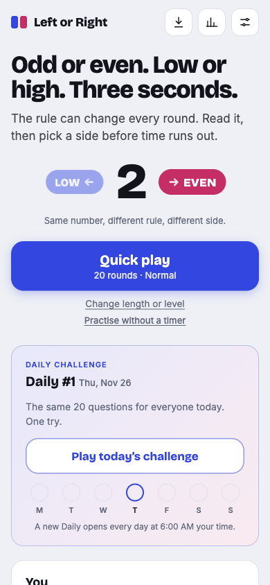
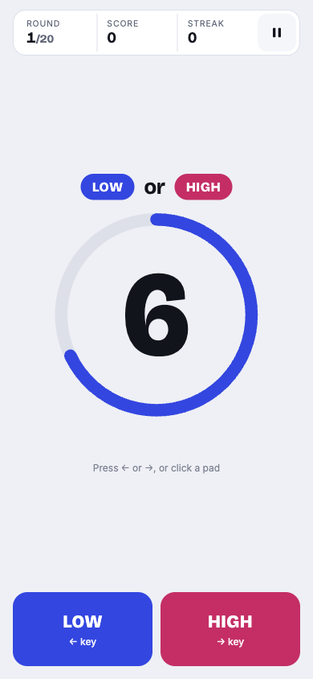
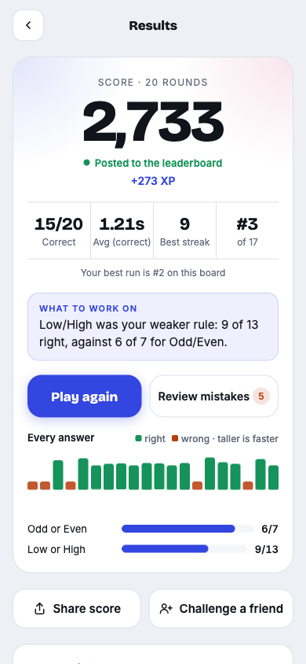

# Left or Right

A three-second reflex game for the browser. A number from 1 to 9 appears with a question: **Odd or Even?** or **Low or High?** Left is odd or low, right is even or high. The question can change every round, so the same number can go left one turn and right the next.

**Play it:** https://left-or-right-peach.vercel.app

No sign-up. It works on phones and desktops, installs as an app, and Classic games play offline.

<p align="center">
  
  
  
</p>

## How it plays

| Question | Left | Right |
|---|---|---|
| Odd or Even? | Odd: 1 3 7 9 | Even: 2 4 6 8 |
| Low or High? | Low: 1 2 3 4 | High: 6 7 8 9 |

- Each answer has 3 seconds. Faster answers and longer streaks score more.
- 5 never appears.
- Answer with the arrow keys (or A and D), by swiping, or by tapping a pad.
- New players get a four-step practice first. Its second step shows the whole idea: 2 goes right as Even, then left as Low.

## Features

**Ways to play**
- **Quick play:** 15, 20, 30 or 50 rounds, Normal or Hard.
- **Hard:** the clock shrinks from 3 s to 1.5 s, numbers can appear as words or dots, and the sides sometimes swap. Each mechanic starts part-way through the game, not all at once.
- **Daily challenge:** the same 20 questions for everyone, one try a day, with streaks and streak freezes.
- **Challenge a friend:** a link that gives a friend your exact questions, with both scores on one board.
- **Untimed practice:** no clock, nothing posted.

**After each game**
- Score, accuracy, best streak and where the run placed ("#3 of 17").
- One takeaway taken from your answers, for example "Low/High was your weaker rule: 9 of 13 right".
- A review that lists your mistakes first, each with a reason where there is a clear one (too early, out of time, rule just changed, sides swapped).
- Share a score card image, or a link whose preview shows the card on LinkedIn, X, WhatsApp and others.

**Progress**
- Levels and 11 badges, counted over every game you've played.
- Stats: score trend, accuracy by question type, and switch cost (how much slower you answer right after the rule changes). Until you've played three games, it shows a starting point instead of a chart.
- Daily reminders by notification, at 6 pm in your time zone, only on days you haven't played.

**Leaderboards and players**
- All-time and weekly boards for each length and level, plus a board per Daily and per challenge.
- Play as a guest straight away; add a nickname later. A player code moves your scores to another device.
- A report button on leaderboard rows, and an admin page for removing or renaming players.

**Built to hold up**
- A finished game is saved on the device before it is sent. Lost connections, timeouts and server errors keep it queued until it posts.
- Offline play for Classic games; the app updates itself when a new version is published.
- Light and dark themes, three text sizes, screen-reader labels and announcements, keyboard play, and layouts checked from a 320 px phone to desktop.

## How scores are checked

The server picks every game's questions and stores when the game started. When a game is submitted, it replays the answers against the same questions and calculates the score itself. It rejects runs that finish faster than the clock allows, answers that are faster than people read and decide, timing that is too even to be human, and second submissions of the same game.

This makes casual cheating hard, but it is not proof: answer times are measured on the player's device, and a careful script could imitate them. The report button and admin page are there for what gets through.

## Built with

- Plain JavaScript, HTML and CSS: no framework and no bundler. A small release script gives scripts and styles content-hashed file names.
- A service worker for offline play and updates.
- [Supabase](https://supabase.com): Postgres and one Edge Function (`api`) that handles every read and write. Browsers have no direct access to the tables.
- [Vercel](https://vercel.com) for hosting, link previews (`@vercel/og`) and a daily keep-alive job.
- The game rules live in one file, `pwa/src/core.js`, shared by the app, the server and the tests.

## Project layout

```
pwa/                    the web app (deployed to Vercel)
  src/                  app code: main.js, core.js (rules), api.js, queue.js (score outbox)
  index.html, styles.css
  api/                  Vercel functions: share-link previews, score-card images, keep-alive
  assets/               content-hashed release files (built by scripts/release.mjs)
  tests/                rules and outbox tests
supabase/
  functions/api/        the game server (Edge Function)
  migrations/           database schema
docs/screenshots/       images used in this README
index.html              the original single-file prototype (a claude.ai artifact)
LAUNCH.md               launch notes and post drafts
```

More technical detail (security, link previews, rules versions, saving scores) is in [pwa/README.md](pwa/README.md).

## Run it locally

You need Node.js 18 or newer and Python 3.

```bash
cd pwa
npm run dev
```

Open http://localhost:5173. After editing anything in `src/` or a stylesheet, stop the server and run `npm run dev` again, so the hashed release files are rebuilt.

The local site talks to the live game server, so finished ranked games post to the real leaderboard. Pages without an extension need it locally: use `/privacy.html` and `/admin.html`. Share links, score-card images and offline mode only work when deployed.

## Tests

```bash
cd pwa
npm run check
```

This runs 33 tests for the rules and the score outbox, and confirms the app and server use the same rules file.

## Deploy

**Web app:**

```bash
cd pwa
npm run deploy
```

Vercel refuses a deploy when the author email on the latest git commit isn't a member of the Vercel team. Set `git config user.email` to your Vercel email, or deploy from a copy outside git:

```bash
cd pwa && node scripts/release.mjs && rm -rf /tmp/lor-deploy && rsync -a --exclude node_modules --exclude .env.local ./ /tmp/lor-deploy/ && cd /tmp/lor-deploy && npx vercel@latest deploy --prod --yes
```

**Game server**, when `supabase/functions/api/` changes. Run `npm run sync-server` in `pwa/` first if you changed `src/core.js`:

```bash
npx supabase@latest functions deploy api --no-verify-jwt --project-ref tnpsckkmlmmozpzkwsly
```

`--no-verify-jwt` is required: the function checks players itself.

## Privacy

The game stores a nickname, game results, a hashed player code and a hashed network address. There are no cookies, no ads and no third-party analytics. Players can delete everything from the stats screen. Details: https://left-or-right-peach.vercel.app/privacy
